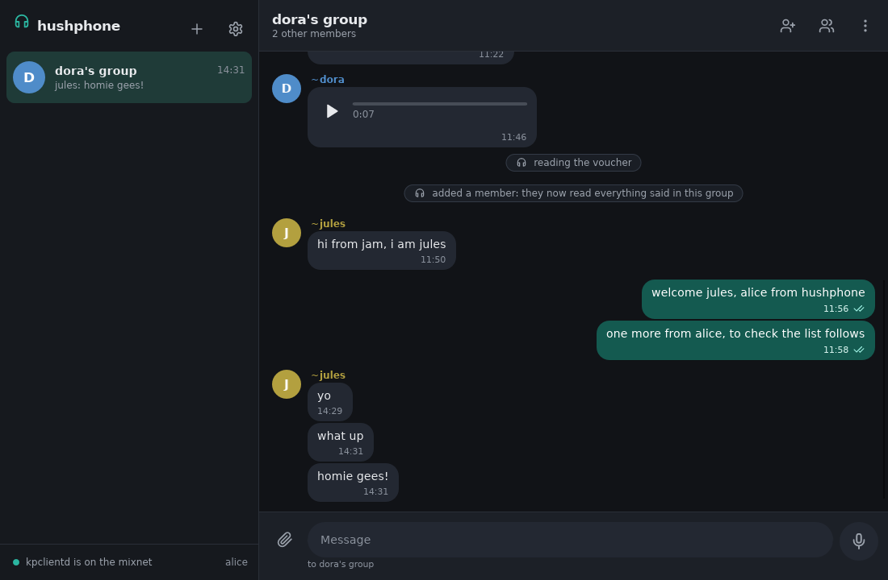
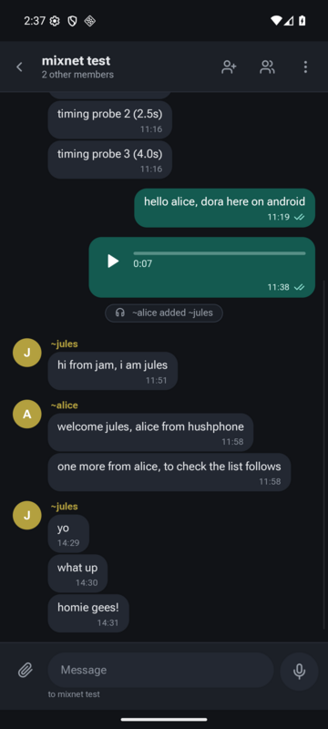

# hushphone

Group chat over the [Katzenpost](https://katzenpost.network) mixnet, with push-to-talk voice
messages, for Linux and Android. It is written in Rust with a [Slint](https://slint.dev) interface.

hushphone speaks katzenqt's group chat protocol through the
[pigeonhole](https://github.com/katzenpost/pigeonhole) client, so its groups are shared with
katzenqt, [jam](https://github.com/katzenpost/jam) and
[frank_chat](https://github.com/katzenpost/frank_chat). Voice messages are Ogg Opus clips recorded
with [rustic_audio](https://github.com/katzenpost/rustic_audio), sent as frank_chat and katzenqt
send them: a file of type `audio/opus` named by its SHA-256.

hushphone does no networking of its own. It needs the Katzenpost client daemon, `kpclientd`,
running beside it.

<p>
  
  
</p>

The same group on the desktop and on Android, over the namenlos mixnet. jules is using jam.

## Linux

```sh
cargo run --release -- --daemon @katzenpost
```

| Flag | |
|---|---|
| `--daemon ADDRESS` | kpclientd's thin client socket: `@name`, a path, or `host:port` (default `@katzenpost`) |
| `--data DIR` | where state, settings and received files live (default `$XDG_DATA_HOME/hushphone`) |
| `--name NAME` | your name, on the first start; otherwise hushphone asks |
| `--sim SOCKET` | use `pigeonhole-sim` instead of the mixnet |
| `--memory` | an in-memory Pigeonhole: nothing leaves the process |

Recording needs ALSA (`libasound2-dev` to build).

## Android

hushphone reaches kpclientd at `127.0.0.1:64331`, where
[kpclientd-android](https://github.com/bfix/kpclientd-android) serves it.

```sh
cargo install cargo-apk
export ANDROID_HOME=~/Android/Sdk ANDROID_NDK_ROOT=~/Android/Sdk/ndk/<version>
cargo apk build --release --lib --target aarch64-linux-android
```

hushphone sets `FLAG_SECURE`, so its window is kept out of screenshots, screen recordings and the
recent-apps view. Test builds made with `--features test-screenshots` leave that flag off; never
ship one.

## Using it

- **Start a group** with New group. Only you see the name you give it.
- **Join someone's group** with Join a group. hushphone mints a voucher over the mixnet and shows
  its code. Give the code to a member of the group over a channel you trust; when they add it with
  Add a member, you join.
- **Talk** by holding the microphone button, or Space while it has focus; let go to send. Escape,
  or dragging away, cancels.
- **Marks** on your messages: a clock while queued, ✓ once written to the replicas, ✓✓ once a
  member has acknowledged reading them.
- **F10** hides the window's contents at once.
- **Theme** follows the system, and is dark when the system does not say. Settings can fix it to light or dark.

## Security

hushphone follows Paw's
[GUI security guidelines](https://github.com/katzenpost/paw/blob/main/docs/GUI_SECURITY_GUIDELINES.md):
whatever other members send is untrusted.

- **Names.** A member's own name is shown as `~name`. Your own name for a member is shown in bold
  instead, and only to you. Names that look alike show the start of the member's key. Names and
  file names lose bidi controls and invisible characters.
- **Content stays in its frame.** Messages are plain text, clipped to their bubble. Long words get
  places to break. The app's own notices use a frame that no message can draw.
- **Controls wait before acting.** A control takes no click until it has been still for half a
  second, so a message that arrives and moves the layout cannot steer a click. A dangerous button
  in a confirmation waits 0.7 s, and the safe one has the focus.
- **Authority follows the user's action.** Only the window's own callbacks can copy, paste, open
  the microphone, pick, save or open a file; nothing that arrives from the network can. Received
  files are never saved or opened on their own, and their type is read from their bytes, not their
  name. A recording indicator is shown for exactly as long as the microphone is open.
- **Notices never take over.** Dialogs open only from your own action. Notices from the network
  never take the focus.
- **On disk.** Settings are written with mode 0600. Logs hold no message text.

## Tests

```sh
SLINT_EMIT_DEBUG_INFO=1 cargo test
```

The tests cover the following:

- The model, text handling, voice naming and settings.
- Two clients over an in-memory Pigeonhole: they join by voucher, exchange text and a voice clip,
  and acknowledge each other.
- The window on mocked time: controls ignore early clicks and clicks after moving, a confirmation
  waits, and push-to-talk works.
- A whole session driven through the window.

## Releases

A `v*` tag runs the tests, then builds the Linux binary and the Android APKs (`arm64-v8a` for
phones, `x86_64` for emulators) twice each, on different machines and in different directories.
The release is published only if both builds are byte for byte the same. Release builds are reproducible:

- `rust-toolchain.toml` pins Rust.
- The Linux build runs in an Ubuntu 22.04 image pinned by digest, with packages from one Ubuntu
  snapshot.
- The Android build pins the NDK, build tools, platform, JDK and cargo-apk, and makes one APK
  per ABI, since cargo-apk orders the libraries of a multi-ABI APK at random.
- Paths and dates are taken out of the output.

To check a release against its source:

```sh
git checkout v0.1.0
img=ubuntu:22.04@sha256:8a2321a92b438238f93b4346fff61bc4259c99fdd4d9b52ee86f153fee0c344f
podman run --rm -v $PWD:/src -w /src $img \
    sh -c 'scripts/linux-env.sh && . /root/.cargo/env && scripts/build-release.sh linux'
sha256sum dist/*.tar.gz
```

The APKs are signed, so a rebuild without the key differs only in its signature. Compare their
entries with `unzip -v`. To rebuild them, use NDK 30.0.16248370, build tools 36.0.0, JDK 21 and
cargo-apk 0.10.0, then run `ANDROID_NDK_ROOT=… scripts/build-release.sh android`.

## License

AGPL-3.0-only; see [LICENSE](LICENSE).
