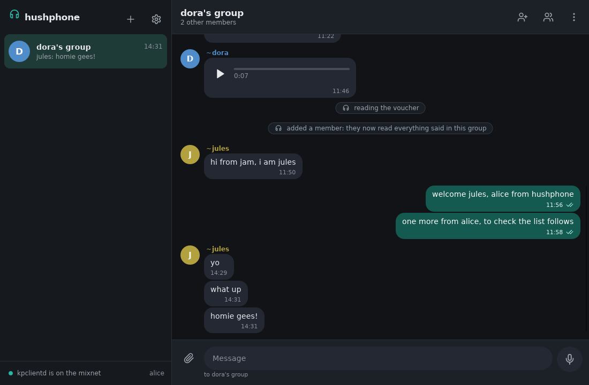
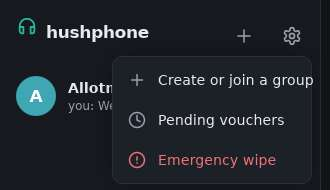
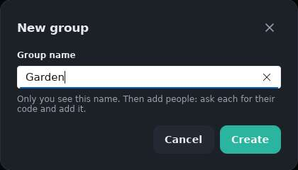
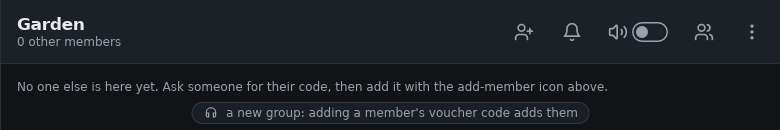
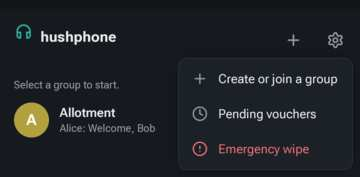
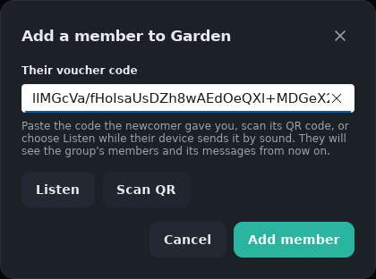

# hushphone

Group chat with push-to-talk voice messages, for Linux and Android. It runs over the
[Katzenpost](https://github.com/katzenpost) mixnet or a [Reticulum](https://reticulum.network) mesh.
Mesh and mixnet members share groups through a bridge replica, and the groups are the same ones
katzenqt, jam, frank_chat and katzenrns use.

<p>
  
  
</p>

hushphone is a client. It does no mixnet networking itself: on the mixnet it needs a running
`kpclientd`, and on the mesh it needs a Pigeonhole replica's address. There are no accounts:
members join a group with a voucher, shown as a QR code or sent by sound.

## Install a release

The [latest release](https://github.com/katzenpost/hushphone/releases/latest) has these files.

- **Android**: the `arm64-v8a` APK (`x86_64` for an emulator), and for the mixnet
  [kpclientd-android](https://github.com/katzenpost/kpclientd-android) too; see
  [docs/android.md](docs/android.md). [Obtainium](https://github.com/ImranR98/Obtainium) can
  install and update it from this repository with the APK filter `arm64-v8a\.apk$`.
- **Debian 13 and Ubuntu 24.04**: `sudo apt install ./hushphone-*-debian-13-amd64.deb` (or
  `ubuntu-24.04`). Its AppArmor profile allows no IP sockets; for the mesh, add the TCP lines
  its [head comment](packaging/apparmor/hushphone) gives.
- **Linux tarball**: `hushphone-<version>-linux-x86_64.tar.gz` holds the `hushphone` binary.
- **Verifying**: with `SHA256SUMS` beside the files, run `sha256sum --ignore-missing -c SHA256SUMS`.

On the mesh, through namenlos's bridge replica, run
`hushphone --transport reticulum --replica 162.220.11.225:4242`. On the mixnet, start `kpclientd`
and run `hushphone`.

## Build from source

Linux, on the mesh, through namenlos's bridge replica. You need [Rust](https://rustup.rs).

```sh
sudo apt install git pkg-config libasound2-dev libfontconfig-dev
git clone https://github.com/katzenpost/hushphone && cd hushphone
cargo run --release -- --transport reticulum --replica 162.220.11.225:4242
```

On the mixnet instead, start `kpclientd` and run `cargo run --release`; see
[docs/building.md](docs/building.md). To build the APK, see
[docs/building.md](docs/building.md#android-apk).

## Joining a group

Creating a group makes no code. To join one, the newcomer makes the code and gives it to someone
already in the group, not the other way round. Below, the newcomer is on Android and the member on
the Linux desktop.

1. The member, if the group is new, chooses **+**, **Create or join a group**, **Start a new
   group** and names it. No code appears: the group waits for one.

   
   
   
   

2. The newcomer chooses **+**, **Create or join a group**, **Join someone's group**, names the
   group and presses **Get a voucher**. hushphone mints a voucher and shows its code.

   
   
   
   

3. The newcomer gives the code to the member: shown as a QR code, sent by sound, or over a channel
   they trust.
4. The member opens the group, presses the add-member icon, scans or pastes the code and presses
   **Add member**. The header says *adding a member…* until the group's keys are on their way.

   
   
   

5. The group appears on the newcomer's side.

   

The direction follows from the cryptography. The group's keys are the secret, and a secret is sent
by sealing it to a public key that its receiver made. Minting the voucher makes the newcomer that
key pair and a mailbox; the code lets the member find both, seal the group's keys to the
newcomer's key and leave them in the mailbox. [docs/vouchers.md](docs/vouchers.md) has more.

## Documentation

- [Building and running](docs/building.md): the three transports, the Android APK, the Debian package, releases
- [Android](docs/android.md) and [flags](docs/flags.md)
- [Using it](docs/using.md), with audio-only mode and ping, and [vouchers](docs/vouchers.md)
- [Security](docs/SECURITY.md): what protects the state, memory and process, and the known gaps

The code is in `src/` (`backend.rs` the client, `bridge.rs` and `model.rs` between it and the
window, `mesh.rs` the Reticulum transports, `voice.rs` push to talk, `sound.rs` vouchers by
sound), the window in `ui/` (Slint), and the Android glue in `android/` and `packaging/android/`.

## Status and compatibility

This tree is version 0.3.7. hushphone writes katzenqt1 wire version 4 by default, or 3 with
`--wire-version 3`, and reads both. Voice clips are Ogg Opus, sent as files as frank_chat and
katzenqt send them. Vouchers by sound are checked against ggwave vectors in `tests/data/ggwave`,
taken from ggwave-rs and pigeonhole_reticulous.

## Testing and licence

`make check test` runs the tests. They cover the model, two clients joining and talking over an
in-memory Pigeonhole, the window and the seccomp sandbox. `tests/namenlos_interop.rs` runs
against a live `kpclientd` and only when `HUSH_INTEROP` is set. AGPL-3.0-only; see
[LICENSE](LICENSE).
