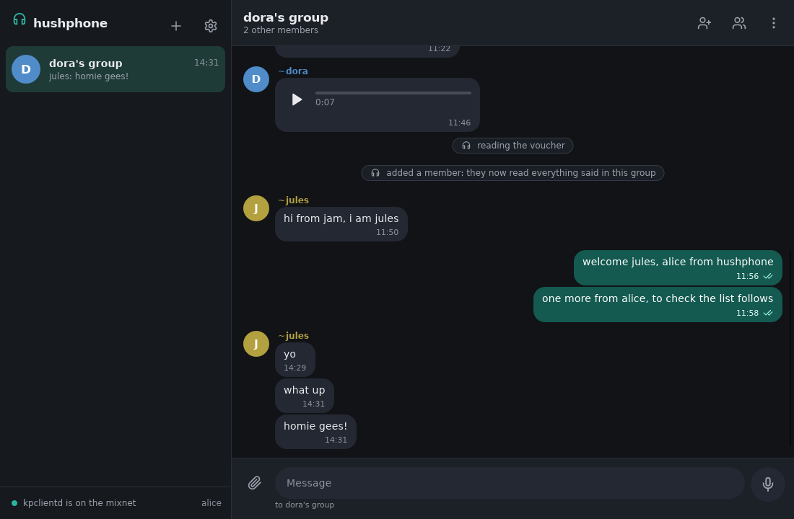
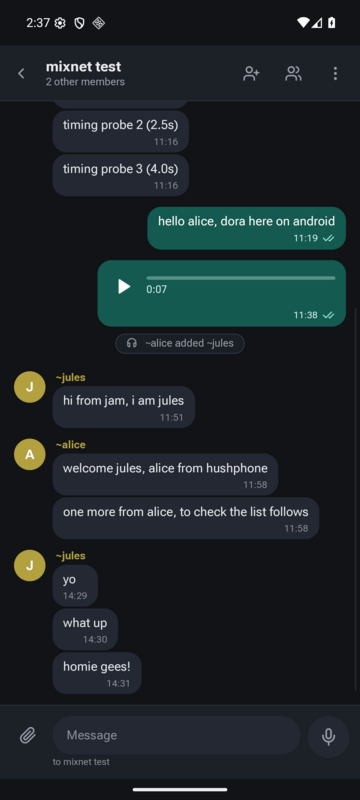

# hushphone

Group chat with push-to-talk voice messages, for Linux and Android. It runs over the
[Katzenpost](https://katzenpost.network) mixnet or a [Reticulum](https://reticulum.network) mesh.
Mesh and mixnet members share groups through a bridge replica. Groups are shared with katzenqt,
jam, frank_chat and katzenrns.

<p>
  
  
</p>

## Quick start

Linux, on the mesh, through namenlos's bridge replica. You need [Rust](https://rustup.rs).

```sh
sudo apt install git pkg-config libasound2-dev libfontconfig-dev
git clone https://github.com/katzenpost/hushphone && cd hushphone
cargo run --release -- --transport reticulum --replica 162.220.11.225:4242
```

On the mixnet instead, start a `kpclientd` (from katzenpost; the mesh needs none) and run `cargo run --release`
(see [docs/building.md](docs/building.md)).

On Android, install the hushphone APK from its releases, and for the mixnet
[kpclientd-android](https://github.com/katzenpost/kpclientd-android) too; Settings picks the mixnet
or the mesh (see [docs/android.md](docs/android.md)).

## Transports

- `mixnet` (default): the Katzenpost mixnet, Needs a running kpclientd (desktop: from katzenpost; Android: [kpclientd-android](https://github.com/katzenpost/kpclientd-android)).
- `reticulum`: a Reticulum mesh, in pure Rust (Reticulum-rs). Needs nothing else installed, no kpclientd. On Android too.
- `reticulum-py`: the same mesh through the Python RNS, embedded in the Rust binary with PyO3. Build with `--features reticulum-py`. No kpclientd.

## Links

- [Building and running](docs/building.md): Linux, the three transports, the Debian package, tests, releases
- [Android](docs/android.md)
- [Flags](docs/flags.md)
- [Using it](docs/using.md) and [vouchers](docs/vouchers.md), shown and scanned as QR codes, or sent by sound (also a T-Deck's)
- [Security](docs/SECURITY.md)

## License

AGPL-3.0-only; see [LICENSE](LICENSE).
