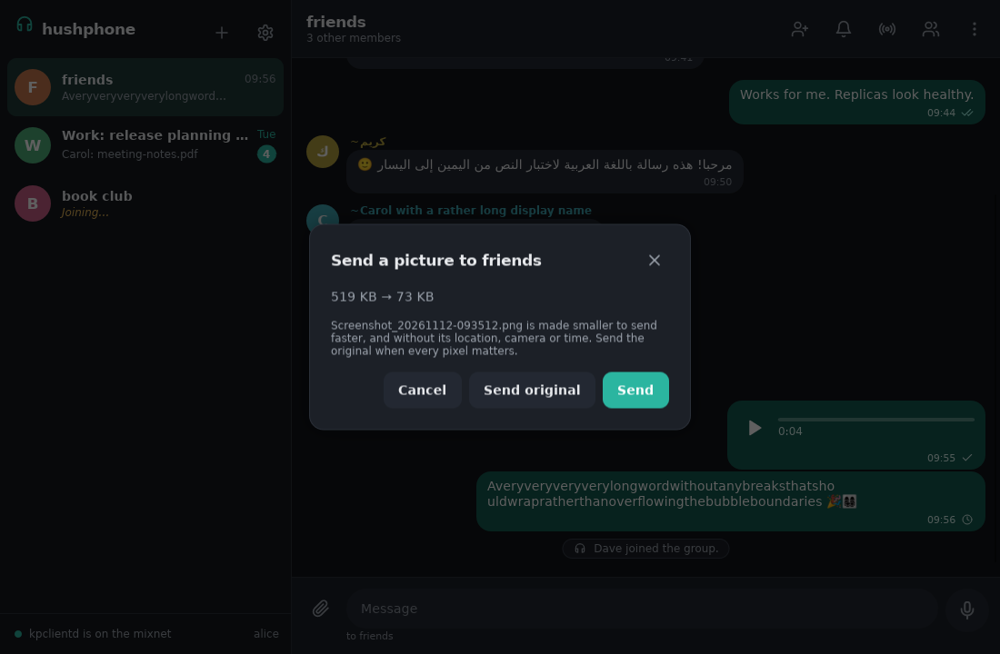
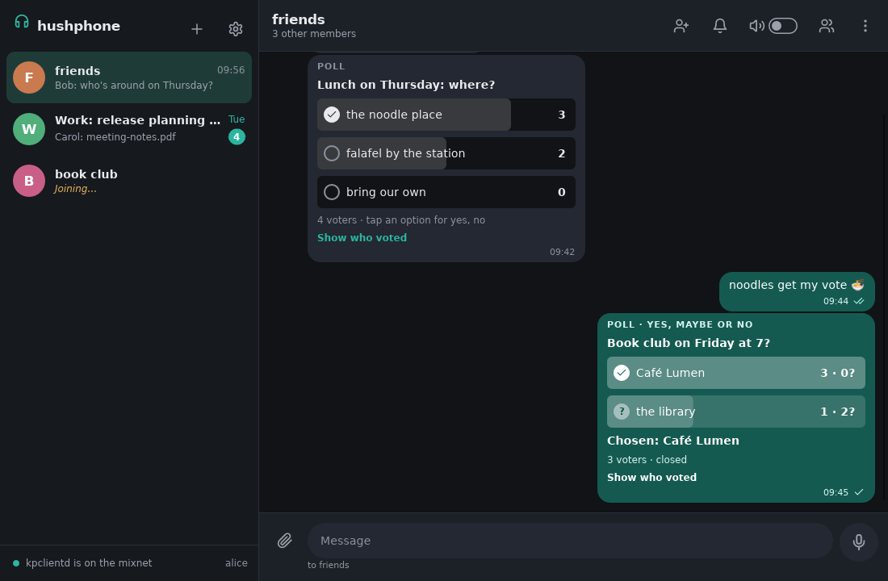
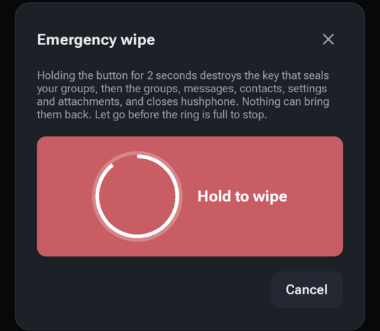
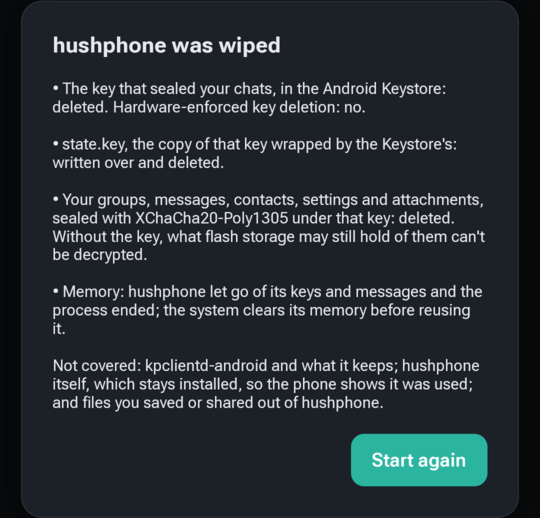

# Using hushphone

- **Start a group** with Create or join a group, then Start a new group. Only you see the name you give it.
- **Join someone's group** with Create or join a group, then Join someone's group. hushphone mints a voucher, over the mixnet or the mesh, and
  shows its code. Give the code to a member of the group over a channel you trust; when they add it with
  Add a member, you join. [vouchers.md](vouchers.md) walks through both sides with
  screenshots.
- **Talk** by holding the microphone button, or Space while it has focus; let go to send. Escape,
  or dragging away, cancels.
- **Audio only**, the speaker switch in a group's header, turns the group into a two-way radio:
  voice messages received from then on play by themselves, one at a time in the order they
  arrive, and you hold the big button to talk. A dot marks a voice message not yet played.
  Switching it off returns to the chat, text and audio.
- **Ping**, the bell in a group's header or Ctrl+P, plays a short tone on every member's device
  and shows who pinged; you hear a roger beep. One ping every 3 seconds at most. It is a few
  bytes, not a sound clip, so it suits slow links such as LoRa.
- **Files.** On Linux, hushphone touches one directory of yours, `~/hushphone`. To send a file,
  put it in `~/hushphone/send` first, then press the paperclip and pick it there. Save puts a
  received file in `~/hushphone/received`, never over another. On Android, the paperclip and
  Save open the system's document picker, which hands hushphone that one file.
- **Pictures** you send (PNG, JPEG or WebP over 20 KB) are made smaller first: at most 1600 pixels
  on the longest side, as a JPEG, turned upright, with transparency shown white and without their
  metadata (location, camera, time). hushphone shows both sizes, such as 286 KB → 54 KB, and
  Send original sends the file untouched. Animations are always sent as they are.
  
- **Polls.** New poll, in a group's ⋯ menu, sends a question and its options, one to a line;
  with "Let members answer maybe", members answer yes, maybe or no to each option, otherwise yes
  or no. Tap an option to change your answer: yes, (maybe,) no, then none again. Every member sees
  the counts as they change, and Show who voted lists each member's answers. The member who made
  a poll can close it, and it then says what was chosen. Polls are katzenqt's: its members see
  and answer hushphone's polls, and hushphone shows theirs.
  
- **Marks** on your messages: a clock while queued, ✓ once written to the replicas, ✓✓ once a
  member has acknowledged reading them.
- **F10** hides the window's contents at once.
- **Theme** follows the system, and is dark when the system does not say. Settings can fix it to light or dark.
- **Screen security**, on Android, is off unless you turn it on in Settings; when on, hushphone's
  screens are hidden from screenshots, screen recordings and the recent-apps preview.
- **Emergency wipe**, in the + menu, opens a large button: hold it for 2 seconds, until the ring
  is full, and hushphone destroys the key that seals your groups, then the groups, messages,
  contacts, settings and attachments, and closes. Let go sooner and nothing happens. The next
  start says what was destroyed and how, then begins afresh. See the [security notes](SECURITY.md).
  
  
