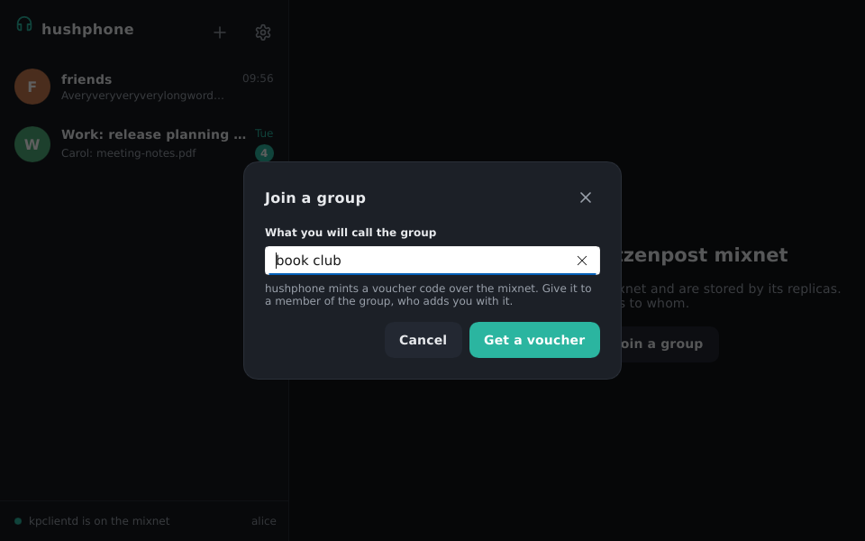
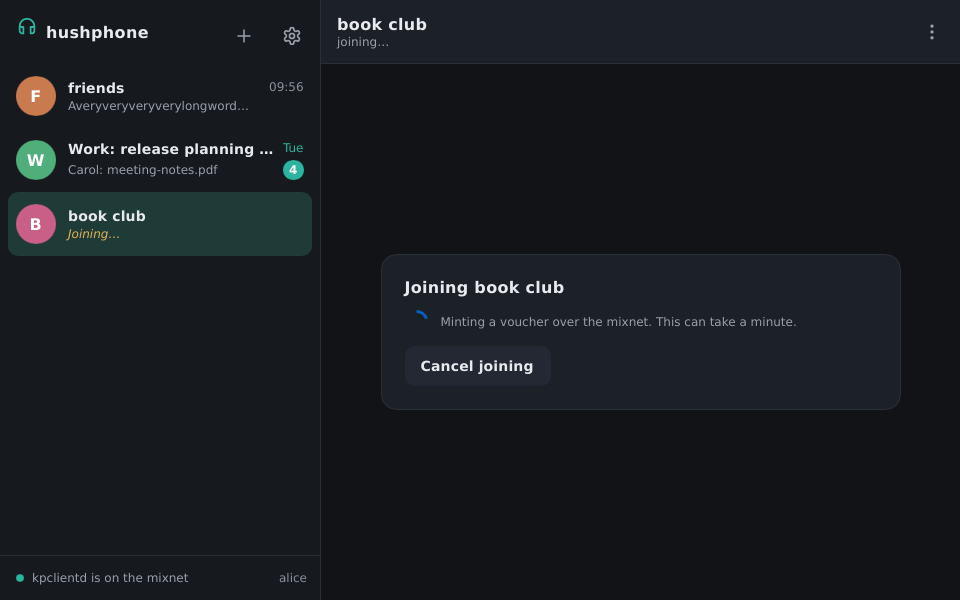
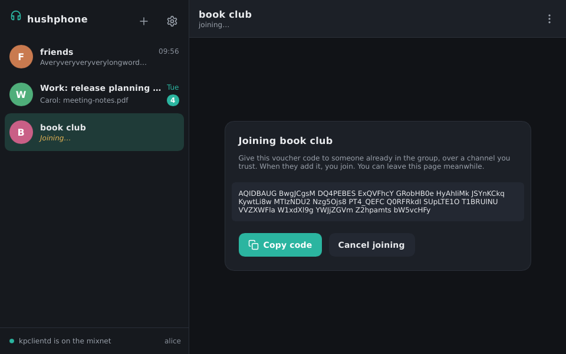
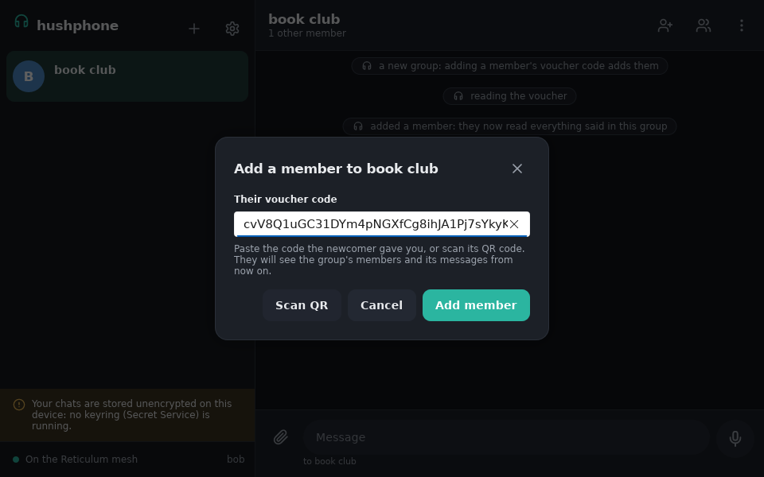
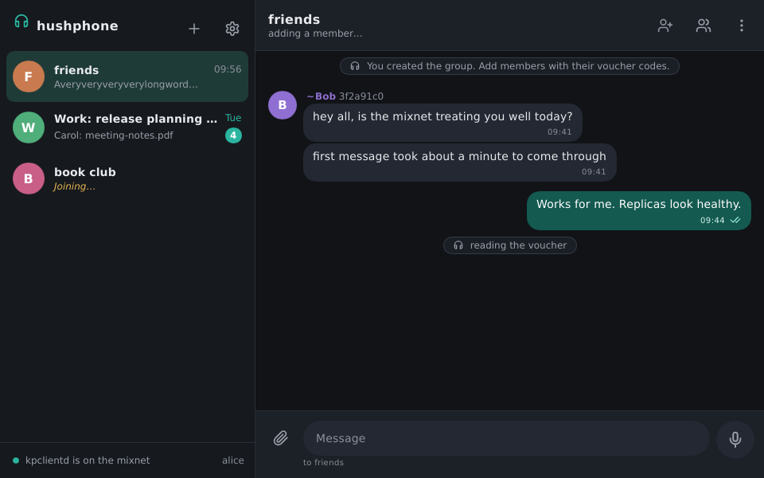
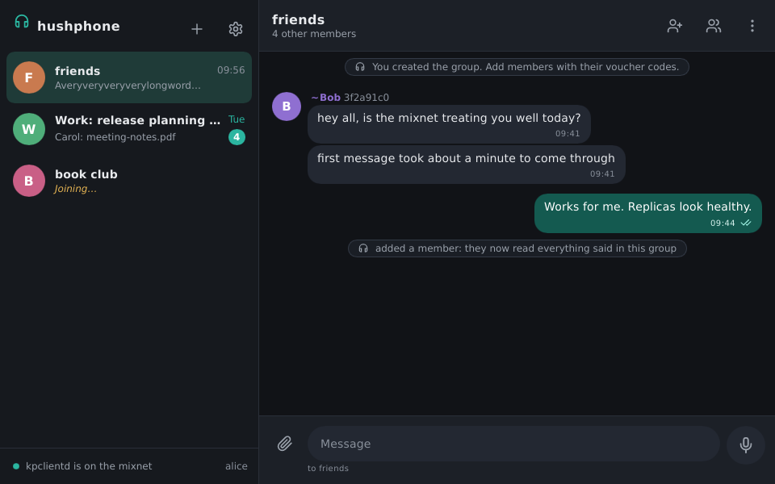
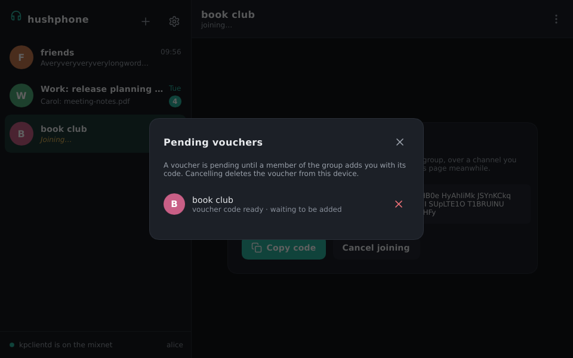

# Vouchers: how someone gets into a group

Nobody can be invited into a hushphone group. There is no address to send an invitation to, and
the mixnet would not let you find one anyway. Instead, the newcomer asks to be let in: they mint
a **voucher**, a one-time key to a mailbox on the mixnet, and hand its code to someone already in
the group. That member drops the group's keys into the mailbox, and the newcomer is in.

So every joining has two sides, done by two people:

| | Who | What they do |
|---|---|---|
| **Newcomer** | the one who wants in | mints a voucher and gives its code to a member |
| **Member** | anyone already in the group | adds the newcomer with that code |

The code is the whole secret. Whoever adds it reads the group from then on, so give it only to
the person who should add you, over a channel you trust: in person, a call, or a messenger you
already share. Never post it.

## The newcomer: get a voucher

Open the **+** menu and choose **Join a group**. The name you give is yours alone; members name the
group for themselves.

hushphone mints the voucher over the mixnet. This takes a minute or so, and the group sits in your
list as *Joining…* meanwhile. You can do other things, or close hushphone: minting carries on next
time it runs.

Once minted, the group's page shows the voucher code. Press **Copy code** and give it to a member
of the group over a channel you trust. Then wait: nothing else is asked of you.

When the member adds the code, the group's messages and members appear on your side, and the
*Joining…* mark goes. The wait is the mixnet's: a few minutes is normal.

## The member: add them with the code

Open the group and press **Add a member**, the icon with a plus next to the person. Paste the code
the newcomer gave you and press **Add member**.

The header says *adding a member…* while hushphone reads the voucher and writes the group's keys
into it. One newcomer is added at a time; a second code is refused until this one is done.

A notice in the group marks the moment they are in. From then on they read everything said in the
group. What was said before stays with those who were there.

## Changing your mind

A voucher that is never added stays pending, on your device only. To see all of them at once, open
the **+** menu and choose **Pending vouchers**. Each row says whether its voucher is still minting
or its code is out there waiting, and the ✕ cancels it, after asking you to confirm.

Cancelling deletes the voucher from your device. A member who adds its code afterwards adds nobody;
to join after all, mint a new one. The **Cancel joining** button on the group's own page does the
same thing.

## If it goes wrong

- **The code is refused** ("That isn't a voucher code"): a character went missing on the way. Ask
  the newcomer to copy it again; the spaces between the groups of eight do not matter.
- **Minting never finishes**: hushphone is not on the mixnet. The dot at the bottom left says so.
  Minting resumes once kpclientd is back.
- **Added, but nothing arrives on the newcomer's side**: give it a few minutes. If a step failed,
  the newcomer's joining page says which, highlighted, and hushphone keeps trying.
